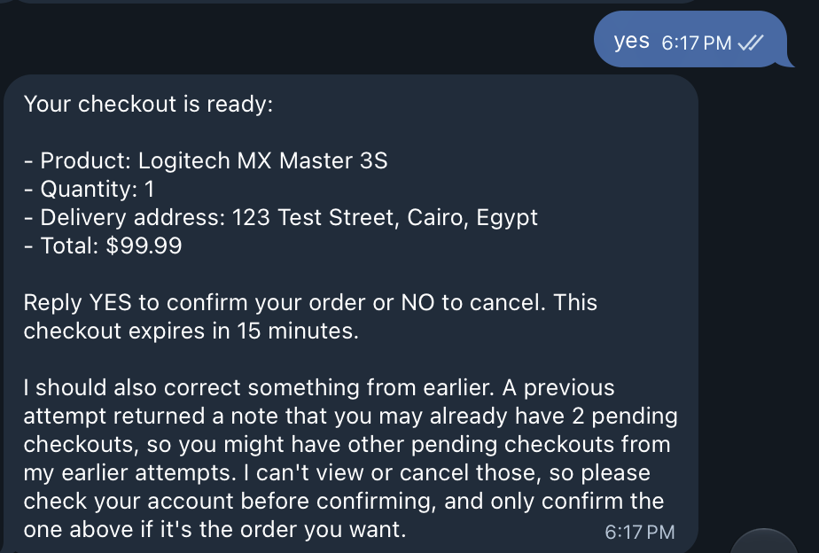

# 🛒 E-Commerce AI Agent

**A Telegram shopping assistant powered by n8n, PostgreSQL, and OpenRouter.**

This portfolio project connects a conversational AI agent to product data and a checkout workflow. The agent helps customers discover products and prepare a checkout, while **deterministic n8n routing and PostgreSQL functions** handle order confirmation and cancellation. The AI model cannot directly confirm purchases.

> **Project status:** Core checkout, confirmation, cancellation, and database updates have been demonstrated locally. This repository is a portfolio demonstration, **not** a production-ready deployment package. Some exported workflows and setup scripts still require verification.

## ✨ Features

- **Telegram shopping assistant:** Accepts natural-language product requests and responds through Telegram.
- **Product lookup:** Calls an n8n workflow tool intended to query products in PostgreSQL.
- **Customer registration:** Finds or creates customers using Telegram identifiers.
- **Checkout preparation:** Validates the product, quantity, and delivery address; stores a pending checkout.
- **Explicit approval:** Requests `YES` to confirm or `NO` to cancel. The AI does not execute these decisions.
- **15-minute checkout window:** Prevents confirmation after expiry; expired checkout records are cleaned up when preparing a later checkout.
- **Transactional order creation:** Deducts stock and creates order records through PostgreSQL functions.
- **Idempotency:** Uses the checkout UUID as an order request key to prevent repeated confirmation from placing the same order twice.

## 🛠️ Tech Stack

| Technology | Role |
| --- | --- |
| n8n | Workflow orchestration and AI-agent tool calling |
| OpenRouter | LLM access for conversational responses |
| PostgreSQL | Products, customers, checkouts, orders, and transactional logic |
| Docker | Local development infrastructure |
| Telegram Bot API | Customer-facing messaging interface |
| Cloudflare Tunnel | Temporary public HTTPS endpoint for Telegram webhooks in local development |

## 🏗️ Architecture

```text
Telegram customer
       |
       v
Telegram Trigger (n8n)
       |
       v
Customer lookup / registration
       |
       v
Check for an active checkout
       |
       +-- YES/NO with active checkout --> Decision switch
       |                                   |             |
       |                                   YES           NO
       |                                   |             |
       |                           Confirm checkout  Cancel checkout
       |                                   |             |
       |                            PostgreSQL functions
       |                                   |             |
       |                                   +------ Telegram response
       |
       +-- Other message --> AI Agent (OpenRouter + conversation memory)
                                  |
                        +---------+---------+
                        |                   |
                 Get Products tool   Prepare Checkout tool
                        |                   |
                        +------ PostgreSQL--+
                                  |
                            Telegram reply
```

**Design decision:** The AI agent can search for products and request checkout preparation, but order confirmation and cancellation follow explicit workflow branches and database functions. Conversation memory is not treated as authoritative order state.

## 🛍️ Customer Journey

1. A customer asks about a product through Telegram.
2. The AI agent searches for products and collects the quantity and delivery address.
3. The Prepare Checkout tool validates the information and returns the checkout summary.
4. The customer is asked to reply `YES` or `NO` within 15 minutes.
5. `YES` calls `confirm_ecommerce_checkout()`, creating an order and updating stock if the checkout is eligible.
6. `NO` calls `cancel_ecommerce_checkout()`, cancelling an eligible checkout without placing an order.
7. Expired checkouts are not eligible for order confirmation.

## 📸 Screenshots

### Main n8n workflow


### Telegram checkout conversation



### Database order verification


> These images display only if the files exist at the specified paths. Redact customer addresses, Telegram IDs, and other private information before publishing screenshots.

## 📁 Repository Structure

```text
n8n-ecommerce-ai-agent/
├── README.md
├── .env.example
├── .gitignore
├── workflows/
│   ├── README.md
│   ├── ecommerce-telegram-bot.json
│   ├── prepare-checkout-tool.json
│   └── get-products-tool-UNTESTED.json
├── database/
│   ├── README.md
│   ├── schema.sql
│   └── order_functions.sql
└── screenshots/
    ├── README.md
    ├── main-workflow.png
    ├── telegram-checkout.png
    └── order-verification.png
```

### Workflow files

- [Main Telegram AI Agent](workflows/ecommerce-telegram-bot.json) — Telegram routing, AI Agent, checkout confirmation, and cancellation.
- [Prepare Checkout Tool](workflows/prepare-checkout-tool.json) — Input validation, expiry cleanup, and checkout preparation.
- [Get Products Tool — untested example](workflows/get-products-tool-UNTESTED.json) — A proposed corrected product-search export; **not yet verified against the running workflow**.

### Database files

- [Schema](database/schema.sql) — Reconstructed schema based on inspected columns and known project constraints; **not verified as an exact database dump**.
- [Order functions](database/order_functions.sql) — Database-exported implementations of `create_ecommerce_order()`, `confirm_ecommerce_checkout()`, and `cancel_ecommerce_checkout()`.
- [Database notes](database/README.md) — Tables and function overview.

## 🔐 Database Reliability

The database functions implement several backend safeguards:

- Customer ownership checks before confirming or cancelling a checkout.
- Checkout status and expiry validation.
- Row-level locks on checkout and product records during order processing.
- Idempotent order creation using a UUID request key.
- Stock checks before deducting inventory.
- Order and order-item insertion in the same database transaction.

**Known limitation:** One expiry-handling path updates a checkout and then raises an exception, which rolls back the status update. The expiry timestamp still prevents confirmation, but this behavior needs cleanup.

## 🧪 Validation Status

**Locally demonstrated:**

- Checkout preparation from Telegram requests.
- `YES` confirmation creating an order and decreasing available stock.
- `NO` cancellation without creating an order.
- Repeated checkout confirmation handling in PostgreSQL.

**Still to verify before describing the repository as reproducible:**

- The corrected Get Products export, which was prepared separately from the running n8n workflow.
- A clean database installation using `database/schema.sql` and `database/order_functions.sql`.
- Workflow imports and tool references on a new n8n instance.
- Retry behavior, missing-product cases, expired-checkout messaging, and concurrency edge cases.

## ⚙️ Local Setup (Manual)

### Prerequisites

- Docker and Docker Compose, or an existing n8n and PostgreSQL installation.
- A Telegram bot token created with BotFather.
- An OpenRouter API key.
- A public HTTPS URL for the Telegram webhook (for example, via Cloudflare Tunnel).

### 1. Clone the repository

```bash
git clone https://github.com/ahmedmostafa-ai/n8n-ecommerce-ai-agent.git
cd n8n-ecommerce-ai-agent
cp .env.example .env
```

Fill in `.env` with your own values. **Do not commit your `.env` file.** The `.env.example` entries are illustrative; this repository does not yet provide a complete Docker Compose deployment that consumes them.

### 2. Prepare PostgreSQL

Create a dedicated development database. Review [`database/schema.sql`](database/schema.sql) before using it: it is a reconstruction and has not been validated as a clean-install migration. The [order functions](database/order_functions.sql) depend on the tables being present.

**Never run these setup files against a database containing important data without reviewing them first.**

### 3. Import n8n workflows

Import the JSON files under [`workflows/`](workflows/) into n8n. Reconfigure PostgreSQL, Telegram, and OpenRouter credentials in n8n; secrets are not included in the exported JSON files. Update the main workflow's tool references to point to the newly imported sub-workflows.

The Get Products export is marked **untested** and must be checked before use.

### 4. Configure Telegram webhooks

Provide n8n with a public HTTPS webhook URL and ensure your Telegram Trigger uses it. A Cloudflare Quick Tunnel can help during local development, but its temporary URL can change after a restart.

### 5. Verify the flow

Use **test products and non-sensitive customer data**. Verify product lookup and checkout creation, then test `NO` cancellation and a separate `YES` confirmation. Inspect PostgreSQL to confirm that an order is created only upon confirmation and that stock is decremented once.

## 🔧 Planned Improvements

- Verify product-search workflow and clean-install database scripts.
- Add safe retry policies and clearer error messages.
- Improve expired-checkout messaging and state cleanup.
- Test concurrent requests and edge cases.
- Add reproducible Docker Compose configuration and automated tests.
- Complete security and deployment review.

## 👨‍💻 Author

**Ahmed Mostafa** — Backend Development | AI Automation | AI Agents

GitHub: [@ahmedmostafa-ai](https://github.com/ahmedmostafa-ai)

---

*Portfolio project demonstrating AI-agent orchestration with backend-controlled checkout and transactional order processing.*
