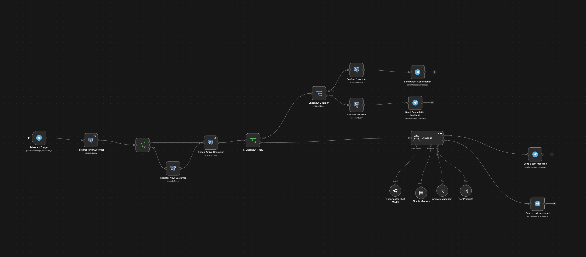

# 🛒 E-Commerce AI Agent

**An AI-powered Telegram shopping assistant built with n8n, PostgreSQL, Docker, and OpenRouter.**

This project demonstrates how AI agents can be integrated with backend workflows to handle customer interactions, product discovery, and order processing.

Instead of allowing the AI model to directly execute purchases, the system uses a confirmation-based checkout process and PostgreSQL functions to manage orders safely.

## 🚀 Features

- **AI-Powered Shopping Assistant:** Understands customer requests through natural-language conversations.
- **Product Search:** Retrieves product information from PostgreSQL using AI Agent tools.
- **Customer Management:** Registers new Telegram customers and recognizes returning users.
- **Checkout Preparation:** Creates checkout sessions containing product, quantity, delivery address, and total price.
- **Order Confirmation:** Customers must explicitly reply `YES` before an order is created.
- **Checkout Cancellation:** Customers can reply `NO` to cancel a pending checkout.
- **Checkout Expiration:** Checkout sessions expire after 15 minutes.
- **Inventory Management:** Product stock is updated when an order is successfully created.
- **Idempotent Order Processing:** PostgreSQL functions prevent repeated confirmation of the same checkout from creating duplicate orders.
  
## 📸 Project Screenshots

### Main n8n Workflow

The main workflow handles incoming Telegram messages, customer registration, AI Agent interactions, and checkout confirmation or cancellation.



### Telegram Shopping Assistant

Customers can search for products, prepare a checkout, and confirm their orders through Telegram.


### PostgreSQL Order Verification

Successful checkout confirmation creates an order in PostgreSQL and updates product inventory.


## 🛠️ Tech Stack

| Technology | Purpose |
|---|---|
| n8n | Workflow orchestration and AI Agent tools |
| OpenRouter | LLM integration |
| PostgreSQL | Products, customers, checkouts, and orders |
| Docker | Local infrastructure |
| Telegram Bot API | Customer-facing chat interface |
| Cloudflare Tunnel | Exposes the local n8n webhook during development |

## 🏗️ System Architecture

The system separates conversational AI from transactional operations.

**Customer interaction:**

Telegram → n8n Telegram Trigger → Customer Lookup → Checkout State Check

**AI workflow:**

AI Agent → Product Search Tool / Prepare Checkout Tool → PostgreSQL

**Order processing:**

Customer replies YES or NO → Deterministic n8n Routing → PostgreSQL Function → Telegram Response

This architecture keeps order confirmation and cancellation outside the AI model's decision-making process.

## 🛍️ Order Workflow

1. The customer sends a product request through Telegram.
2. The AI Agent searches for the requested product.
3. The agent collects the quantity and delivery address.
4. A checkout session is prepared and saved in PostgreSQL.
5. The customer receives an order summary and a YES/NO confirmation request.
6. If the customer replies `YES`, PostgreSQL creates the order and updates inventory.
7. If the customer replies `NO`, the checkout is cancelled without placing an order.
8. Expired checkouts cannot be confirmed.

## 🔐 Database Reliability

The project uses PostgreSQL functions for transactional order creation and inventory updates.

Key backend concepts include:

- Database transactions
- Row-level locking
- Idempotency using unique request identifiers
- Stock validation
- Checkout state validation
- Customer ownership verification

These mechanisms reduce the risk of duplicate orders and inconsistent inventory.

## 📂 Repository Structure

## 📁 Project Files

### n8n Workflows

- [Main Telegram AI Agent](workflows/ecommerce-telegram-bot.json) — Handles customer messages, AI interactions, checkout confirmation, and cancellation.
- [Prepare Checkout Tool](workflows/prepare-checkout-tool.json) — Validates purchase information and manages checkout sessions.
- [Get Products Tool](workflows/get-products-tool-UNTESTED.json) — Product-search workflow example. Requires testing before use.

### PostgreSQL Database

- [Database Schema](database/schema.sql) — Database tables and relationships.
- [Order Processing Functions](database/order_functions.sql) — Transactional order creation, checkout confirmation, cancellation, and idempotency.
- [Database Documentation](database/README.md) — Overview of the database architecture.

**Note:** Workflow exports are sanitized for public sharing. Importing them requires configuring credentials, workflow references, and the PostgreSQL database. Some setup and regression tests remain outstanding.

Workflow exports, database scripts, and screenshots will be added as the repository documentation is completed.

## 🧪 Testing

The core workflow has been tested using Telegram and PostgreSQL.

Verified scenarios include:

- Product retrieval through the AI Agent
- Checkout preparation
- Order confirmation and inventory updates
- Checkout cancellation
- Idempotent confirmation behavior
## ⚙️ Local Setup

### Prerequisites

- Docker and Docker Compose
- n8n with PostgreSQL and OpenRouter support
- PostgreSQL database
- Telegram bot created using BotFather
- OpenRouter API key
- Public HTTPS endpoint for Telegram webhooks (for example, Cloudflare Tunnel)

### 1. Configure the environment

Clone the repository and create a local environment file:

```bash
git clone https://github.com/ahmedmostafa-ai/n8n-ecommerce-ai-agent.git
cd n8n-ecommerce-ai-agent
cp .env.example .env
```

Update `.env` with your own configuration values. Never commit real credentials.

**Note:** The repository does not yet include a Docker Compose file. Set up n8n and PostgreSQL using your existing
## 🔧 Planned Improvements

- Additional error handling and retry safety
- Expired-checkout edge-case testing
- Concurrent request testing
- Security review
- Final regression testing

## 👨‍💻 Author

**Ahmed Mostafa**

Backend Development | AI Automation | AI Agents

GitHub: [@ahmedmostafa-ai](https://github.com/ahmedmostafa-ai)

---

*Personal portfolio project demonstrating AI agent orchestration and backend-integrated workflow automation.*
